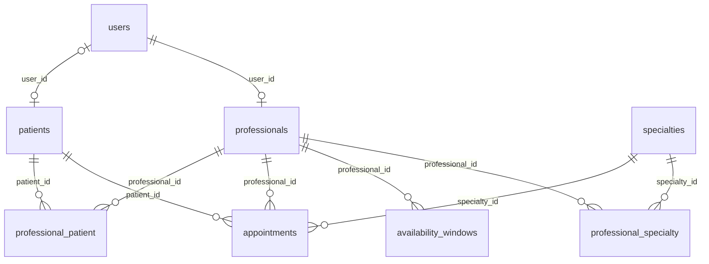

# new-design.md — san-benito (constitución de producto v1)

Constitución de producto v1.

Este archivo es la **única fuente de verdad de producto**. `DESIGN.md` (slots `available` pre-creados) se retiró: contradecía el modelo de franjas. Quien implemente debe seguir **este** documento. Si algo no está acá, **no se inventa: se pregunta** (§12). Visual: [`design.md`](design.md).

El producto usa **Fortify** (`routes/auth.php`): email + contraseña. No hay atajo de login por rol sin password.

**Modelo de disponibilidad (dueño, 2026-09-09):** no hay fila de “turno disponible”. El professional (o el admin, para cualquier professional) persiste **franjas de trabajo**. Los huecos de 20 min (u otra duración) se **calculan** al leer. Recién al reservar o asignar se inserta `appointments`.

---

## 1. Alcance de la v1

Incluye:

- Autenticación: login Fortify (email + password) y **registro público de paciente** (d13).
- Tras auth, **home de portal** si el rol trae `portal.home` (paciente o professional, `#page-home`). Admin / super_admin no tienen ese permiso: entran por las mismas credenciales Fortify y caen en las pantallas admin **heredadas**.
- Portales paciente y professional con la IA, chrome y flujos de la demo Pruebas (secciones 7–9).
- Capacidades admin / super_admin (la demo admin es **stub**: no hay UI admin que copiar): listar/filtrar reservas, alta de profesionales, catálogo **Pacientes** y **Administradores** (`super_admin`, d37), catálogo de especialidades (`super_admin`, d34), cargar **franjas** para cualquier professional.
- Relación professional–paciente (pivote); **Mis pacientes**; alta manual del vínculo; **asignar** paciente vinculado a un hueco **calculado** (aún no persistido).

**Fuera de alcance v1** (no implementar nada de esto):

- Sitio institucional, landing de marketing, `welcome.tsx` como home de invitado.
- Selector de pieles / temas de la demo (cinco diseños). El producto usa `design.md` + chrome Pruebas (§9).
- Mails o notificaciones de cualquier tipo.
- Estado `completed` / “turno atendido”.
- Historial de cancelaciones / auditoría (cancelar **borra** la reserva; no queda fila).
- Agenda recurrente, rrule, jobs. `createSlotsFromRange` (una ventana → muchas filas `available`) **no es** este producto.
- Pre-materializar huecos como `appointments` con `status = available`.
- Recordatorios, multi-sede, multi-tenant, API pública, historia clínica.
- Borrado / desvinculación de `professional_patient`.
- Metadatos extra en el vínculo (obra social del vínculo, notas, etc.).
- UI admin inventada a partir del stub.
- Atajo de login “entrar como admin” / botones de rol sin password.

**Guest `/`:** login (o redirect a login). No hay landing de producto.

---

## 2. Registro de decisiones

Decisiones ya tomadas. **No reabrir** D1, D2, D8, D10. D9 tiene la excepción de paths de abajo.

- **D1 — Single-tenant**: una sola institución. Sin teams ni scoping por tenant.
- **D2 — Patrón de datos: Services + Eloquent directo.** No hay capa Repository.
  Reglas duras: (a) los controllers **nunca** hacen queries ni contienen lógica — solo
  reciben el request validado, llaman a un service y devuelven una respuesta Inertia;
  (b) toda query reutilizable se encapsula como **scope de Eloquent** en el modelo.
- **D3 — Disponibilidad manual por franjas**: el professional carga a mano **bloques de trabajo** (fechas concretas × rangos horario). No hay agenda recurrente ni rrule. **No** se insertan turnos vacíos.
- **D4 — Especialidades catalogadas**: tabla `specialties`, relación N:N con `professionals` vía pivote `professional_specialty`. No es texto libre. El **alta** de professional exige al menos una especialidad. Después, el catálogo (d34) puede dejar a un professional en cero (borrar la especialidad o destildarlo en el edit).
- **D5 — Cancelación**: pueden cancelar el paciente (sus turnos), el professional (turnos de su agenda) y admin/super admin (cualquiera). **Sin límite horario**: se puede cancelar hasta el horario de inicio del turno.
- **D6 — Al cancelar se borra la reserva**: hard delete de la fila en `appointments`. La **franja sigue**; ese horario vuelve a ofrecerse al calcular huecos. Sin historial de **cancelaciones** en v1 (aceptado). Las reservas cuyo horario ya pasó siguen en `appointments` y se listan en **Historial de turnos** (d33). **Reemplaza** el D6 de `DESIGN.md` (reabrir `status = available`).
- **D7 — Sin estado `completed`** en v1. `appointments` **solo** guarda reservas: no hay enum `available` / `booked`.
- **D8 — Sin mails** en v1. El contenedor `queue` existe por paridad de stack pero no hay jobs; no crear Mailables ni Notifications.
- **D9 — Idioma**: código, tablas, nombres de ruta, nombres de archivo y paths de acción en **inglés**; textos visibles de UI en **español**. Excepción: el path de un GET que renderiza Inertia va en **español**. El prefijo de staff queda **`admin`**, corto, nunca `administracion`. Las acciones (`POST` / `PATCH` / `PUT` / `DELETE` y los GET que responden JSON) viven en la raíz, en inglés, sin prefijo `/paciente`, `/profesional` ni `/admin`.
- **D10 — Roles y entidades separados** (modelo mixto): las entidades `Professional`/`Patient` guardan datos de dominio. Los services los mantienen consistentes (crear Professional, o Patient **con cuenta**, ⇒ `assignRole` en ese user; una ficha Patient sin cuenta no crea `users` ni asigna rol). El **rol** es un paquete de permisos asignable a un usuario (v1: un rol por alta, d37). El **permiso** define el alcance (zona + own vs any). Árbol: ¿es una capacidad/zona? → `can('permiso')` / middleware `permission:`. ¿este user es el tipo professional/patient/admin? → `hasRole` (crear entidad, chrome Patient/Home vs Professional/Home). Prohibido tratar `$user->professional` (o `patient`) como prueba de capacidad. Prohibido un user sin password o sin rol para simular una ficha sin cuenta.
- **D21 — Relación professional–paciente explícita**: tabla pivote `professional_patient` (`unique(professional_id, patient_id)`), independiente de `appointments`. Nace al **reservar** (paciente), al **asignar** (professional) y por **alta manual** (professional / admin). Idempotente: `firstOrCreate`. **No se borra en v1** (cancelar un turno no toca la pivote ni las franjas).
- **D31 — Huecos calculados, reserva persistida**: la UI puede mostrar “14:00 — 14:20” como turno. Eso es `franja ÷ slot_duration_minutes` menos reservas. Persistencia: `availability_windows` al programar; `appointments` **solo** al book/assign.

Decisiones menores (vetables por el dueño):

- **d11 — Validación**: una **franja** exige `ends_at > starts_at`, no solapar otra franja del mismo professional, y ser lo bastante larga como para al menos un hueco (`>= slot_duration_minutes`). Una **reserva** exige futuro, `ends_at = starts_at + slot_duration_minutes`, alineación al inicio de una franja (n × duración), caber en esa franja, no solapar otra reserva del mismo professional. Constraint `unique(professional_id, starts_at)` en `appointments`.
- **d12 — Borrado**: no existe “eliminar horario disponible” como fila. Ese CTA de la demo era del modelo viejo (borrar un `available` que nadie reservó). En v1: se **borra o no se carga la franja**. Una reserva no se “elimina” por ese camino: se **cancela** (D6). Si la franja a borrar todavía tiene reservas futuras → **no borrar** (error); primero cancelar esas reservas, o preguntar al dueño si se permite borrar franja con reservas (hoy: no).
- **d13 — Registro de paciente**: campos requeridos `name`, `email`, `password`, `dni`, `birth_date`; opcionales `phone`, `health_insurance`. `POST /register` hace `Auth::login` y dispara `Registered`. Árbol: (1) si ya existe `users.email` → 422, sin merge contra professional, admin, super_admin ni paciente que ya tiene cuenta; (2) si no hay user con ese mail y existe `patients.email` con `user_id` null → **attach**: se crea el User (`name`, `email`, `phone`, `password` del formulario), `assignRole('patient')` y se setea `patients.user_id` del **mismo** `patients.id` (no se mueven `appointments`, `professional_patient` ni `patient_health_insurance`); si `dni` o `birth_date` del formulario difieren de la ficha → 422 y cero escrituras; `name` y `phone` del formulario pisan `patients` y `users`; la obra de la ficha no se toca aunque el formulario mande otra; (3) si no hay user ni ficha con ese mail → alta actual (user + patient + rol `patient`). La llave de match es solo el email en minúsculas (no el DNI). `/register` sigue activo.
- **d14 — Redirección post-login (reemplaza el d14 de DESIGN.md)**: quien tiene `portal.home` y rol `patient` → `#page-home` (`GET /paciente`); quien tiene `portal.home` y rol `professional` → `#page-home` (`GET /profesional`); quien no (`admin`, `super_admin`) → `GET /admin`, que redirige a `/admin/reservas` (no hay home admin en la demo). `GET /` y `GET /home` autenticados redirigen a esa home de rol. **No** redirigir a `/paciente/profesionales` ni a `/profesional/agenda`. No inventar un permiso inverso tipo `staff.skip-home`.
- **d15 — Vista calendario**: **Mi agenda** (professional), **Mis turnos** en modo Mensual (paciente) y **horarios de un professional** muestran calendario mensual a la izquierda y detalle del día en el **panel derecho** (sin modal). En **Mis turnos** modo Mensual el panel del día es una timeline de las reservas de ese día (profesional y especialidad; sin franjas ni huecos); si no hay día elegido porque no hay reservas futuras, el texto es «No tenés turnos próximos.». En la agenda professional, si no hay día elegido: “Turnos de hoy”. En **Mis turnos**, los días anteriores a hoy (zona institucional) están **deshabilitados** (d33). Tonos del cal professional: sin franja / hay huecos libres / todos los huecos de ese día están reservados.
- **d16 — Cargar un bloque corto (classic)**: en **Mi agenda**, CTA **Cargar un turno** abre un modal de página (d44; hora de inicio + franjas del día con **Borrar franja**; no está en el panel del día). Query `panel` ∈ {`day`, `load`}; omitir `panel` (o cualquier otro valor) = `day`; omitir `date` = hoy. `panel=load` en la URL solo abre el modal al cargar la página; los CTAs abren el modal sin GET. Solo hora de inicio; el servidor persiste una **franja** de `[starts_at, starts_at + slot_duration_minutes)`. No inserta `appointments`. El range-en-el-día del panel de agenda de `DESIGN.md` no aplica: las franjas largas van a **Programar** (d25).
- **d17 — Zona horaria**: `APP_TIMEZONE=America/Argentina/Buenos_Aires`. `starts_at`/`ends_at` son hora de pared de la institución. Serializar sin sufijo `Z`; el frontend formatea sin convertir a UTC del navegador.
- **d18 — Búsqueda de profesionales**: en `#page-professionals` se filtra por **especialidad** (incluye opción “Todas”, **predeterminada**) y/o **nombre**. Sin especialidad concreta (vacío o `all`) se listan **todos** los profesionales **con al menos una especialidad**. Un professional en cero (d34) **no** aparece ahí. Mismo default “Todas” en `/admin/profesionales` (d36), que **sí** lista los de cero. El wizard Reservar (d24) sigue pidiendo elegir especialidad en el primer paso.
- **d19 — Turnos próximos (ajustado por la demo)**: en el **home** de portal se listan hasta **3** **reservas** de la semana en curso, no los 5 de DESIGN.md. En `#page-slots`, sin día elegido, el panel lista los **5 días** próximos con al menos un hueco calculado libre (no es una lista de horarios; no hay toggle Lista/Calendario ahí). En el wizard paso Horario **lista** (GET `/paciente/reserva` **sin** `date`), hasta **12 días** con **un** hueco ofertado por día civil (d39). Con `date` (calendario), el panel de ese día muestra ese único hueco. Lista y cal **no divergen** en qué hueco existe. En **Mis turnos** ya no hay modo Lista: las reservas futuras se ven en Semanal y en Mensual (d28). Las pasadas van a **Historial de turnos** (d33).
- **d20 — Duración de turno por professional**: `slot_duration_minutes` (default **20**, rango **5–120**). Se configura en **Config. agenda**. Cambiar la duración **no** muta franjas ni reservas ya guardadas. Se usa al **calcular** huecos (y al crear el bloque corto d16). Un hueco que solape una reserva existente no se ofrece.
- **d21 — Alta manual del vínculo**: el professional solo vincula pacientes **a sí mismo**; admin/super_admin puede vincular **cualquier paciente a cualquier professional**. Búsqueda por nombre, DNI o correo (`patients.name`, `patients.dni`, `patients.email`), incluidas las fichas con `user_id` null; **mínimo 2 caracteres**. Par duplicado: idempotente.
- **d22 — Mis pacientes (UI)**: cards con **nombre, DNI y obra social** (el nombre de la obra, o **Particular** si no hay fila). Debajo de esos datos, los CTAs **Más información** (perfil) y **Asignar turno**. La card **no** navega al click. Vacío: “Todavía no tenés pacientes vinculados.” Toolbar d41: primario nombre, DNI o correo + Buscar; **Filtros** con obra social y especialidad (ambas “Todas”, **predeterminadas**). La obra social lista solo las que ese professional acepta. La especialidad lista solo las suyas. Obra social deja pacientes (vinculados y candidatos) cuya obra es esa. Especialidad deja los que tienen al menos un turno con **este** professional en esa especialidad. Un id que no es de su catálogo no coincide con nadie. Sin esos filtros se listan todos los vinculados; la búsqueda de no vinculados sigue pidiendo ≥ 2 caracteres.
- **d23 — Entrada de producto**: pantalla de login Fortify → `#page-home` del rol (paciente o professional). El login demo (tres botones de rol) **no** se copia. No hay atajo “entrar como admin”; admin entra con email + password si tiene el rol.
- **d24 — Wizard Reservar turno**: tres pasos **Especialidad → Profesional → Horario**. El paso Especialidad lista solo especialidades **con al menos un professional** (una en cero por d34 no aparece). En Profesional y Horario, **Atrás** en el header vuelve al paso anterior (igual que Programar): Horario → Profesional (conserva `specialty_id`); Profesional → Especialidad. En el paso Profesional solo aparecen profesionales con **al menos un hueco calculado libre** (horizonte 60 días, mismas reglas que d11); sin hueco → no se listan. Se marca **Turno más cercano** al de primer hueco más próximo; esa card va primero. Si ninguno tiene hueco, lista vacía. El paso Horario tiene toggle Lista / Calendario **local** (d28; no manda `mode`). Oferta de horario: d39. Reservar **inserta** la cita (no hace UPDATE de un slot) con `specialty_id` = la especialidad del paso 1 (d38).
- **d25 — Programar franjas (N×M)**: wizard **Cuándo → Horario**. El professional pinta N días y carga M franjas (inicio/fin). En Horario, las M franjas también se **pintan** sobre una `DayTimeline` (misma escala `slot_duration_minutes`, sin reservas ni sombreado de pasado): arrastrar en zona libre agrega (se une con las que toca o solapa; mínimo = un turno), arrastrar desde dentro de una franja borra ese tramo (restos menores a un turno se descartan). Inicio/fin + **Agregar franja** y la lista con **Quitar** siguen como alternativa. El servidor persiste **N × M filas** en `availability_windows` (cada par día + rango), **all-or-nothing**, sin generar `appointments`. Checkbox **Bloquear fines de semana**. Remanente incompleto **no** se guarda como hueco: se descarta al **calcular** (la franja se guarda entera). Si el rango es más corto que la duración → error al persistir. En la demo, `draftFranjas` + Listo no escriben; Laravel v1 **sí** escribe franjas. `createSlotsFromRange` actual **no cubre** este flujo.
- **d26 — Asignar (professional)**: en Mi agenda el turno se asigna tocando un hueco de la timeline (d46), que abre `AssignModal` (d45) con el día y el horario fijos. En Mis pacientes y en el perfil, el CTA **Asignar turno** abre el mismo modal en esa página, con el paciente preelegido. Elige un hueco **calculado** (cualquiera, no el “primero del día”), un paciente **ya vinculado** y una **especialidad** de su catálogo; **inserta** vía `assign` (`isBookableSlot` + unique; **sin** overflow d39) + `firstOrCreate` en `professional_patient`. Si tiene exactamente una especialidad, el campo no se muestra y ese id viaja en el POST. No busca no-vinculados en ese flujo.
- **d27 — Perfiles**: `#page-professional-profile` (paciente) y `#page-patient-profile` (professional). Campos demo sin schema → §4 (decisión abierta). Quien tiene `specialties.manage` ve **Asociar especialidad** en el perfil del professional. Paciente: `GET /paciente/profesionales/{id}`. Staff: `GET /admin/profesionales/{id}` (mismo prefijo que el listado). El CTA va a `GET /admin/profesionales/{id}/especialidades` (checkboxes + `PATCH /professionals/{professional}/specialties`, sync; puede quedar en 0). Atrás → perfil. Sin ese permiso: no ven el CTA y la GET es 403.
- **d28 — Semanal / Mensual y Lista / Calendario**: **Mis turnos** arranca en Semanal; toggle a Mensual (estado local de ViewSwitch; no manda `mode`). El wizard Horario arranca en Lista; toggle a Calendario.
- **d29 — Feedback**: toasts flotantes + modal de página para confirmar (cancelar reserva / borrar franja). **No** “silent success” de `design.md`.
- **d30 — Controles de hora**: `time24Html` (hora 0–23 + minutos, **step 5 min**), no `input type=time` nativo.
- **d32 — Admin y franjas**: admin/super_admin pueden cargar franjas **para cualquier professional** (mismo contrato N×M o bloque corto). Sin UI en la demo: solo capacidad + endpoint heredado a adaptar. No inventar wizard admin.
- **d33 — Historial de turnos (paciente)**: en **Mis turnos** modo Mensual, los días anteriores a **hoy** (zona institucional) están deshabilitados y no se navega a meses ya enteramente pasados. En modo Semanal la grilla arranca en **hoy** (zona institucional) y no muestra días pasados: una sola tabla, horas a la izquierda y un solo scroll, con 7 columnas en escritorio y 5, 4 o 2 al achicarse. No se navega hacia atrás de hoy. El header tiene **Historial de turnos** (hijo de `#page-my`) con las reservas cuyo `starts_at` ya pasó (`<= now()`), más recientes primero. Sin **Cancelar** ahí (D5: el horario de inicio ya ocurrió). No es historial de cancelaciones (D6 sigue: cancelar borra la fila).
- **d34 — Catálogo de especialidades (super_admin)**: pantalla **Especialidades** (`/admin/configuracion/especialidades`), hija de **Configuración** (`/admin/configuracion`). El hub de Configuración solo lista accesos a esta y futuras secciones (sin el catálogo embebido). Lista de lectura: nombre, cantidad de profesionales, **Editar** y **Eliminar**. Crear (GET `/admin/configuracion/especialidades/crear`, d35). Editar abre `GET /admin/configuracion/especialidades/{specialty}/editar` (nombre + profesionales asociados vía checkboxes; **buscador por nombre** en el listado, filtra en cliente y no destilda los ocultos; `PATCH` con `name` y `professional_ids`, sync de la pivote; un professional puede quedar en 0). Desde el perfil del professional, el mismo permiso asocia especialidades al revés (`GET /admin/profesionales/{id}/especialidades` + `specialty_ids` sobre ese professional, d27; mismo buscador). Nombre único, no vacío. Eliminar borra la especialidad y las filas de `professional_specialty` (FK `cascadeOnDelete` en `specialty_id`); no borra profesionales. **Falla** si hay `appointments` (pasadas o futuras) con esa especialidad (`appointments.specialty_id` `restrictOnDelete`, d38). `admin` (sin super) no accede. UI heredada (mismo chrome que Pacientes).
- **d35 — Alta admin lista primero**: en `/admin/profesionales`, `/admin/administradores`, `/admin/pacientes` y `/admin/configuracion/especialidades` la vista inicial es la **lista**; el formulario de alta **no** está visible. En **Profesionales** y **Pacientes** el CTA del header abre un modal de página (chrome d29) sobre esa lista; no navega. `GET /professionals/create` y `GET /patients/create` siguen (`professionals.create` / `patients.create`) y responden **JSON**, sin página Inertia: profesionales `{ specialties, healthInsurances }`; pacientes `{ healthInsurances }`. El modal los pide al abrirse. Éxito (toast) **redirige** a la lista y cierra el modal. Error de validación (422) deja el modal abierto. **Volver** / Escape / click afuera cierran. En **Administradores** y **Especialidades** el CTA sigue yendo a `GET .../create` (`/admin/administradores/crear`, `/admin/configuracion/especialidades/crear`). Atrás (Link) vuelve a la lista. Éxito (toast) **redirige** a la lista (no `back()` al `/create`). Error de validación (422) se queda en la GET `/create`. En Especialidades, eliminar sigue en cada fila; el rename y los asociados van a `/editar`. En el alta de professional el listado de especialidades tiene **buscador por nombre** (filtra en cliente; no destilda los ocultos). En Pacientes el alta pide los campos de paciente.
- **d36 — Catálogos admin (chrome unificado)**: `/admin/reservas`, `/admin/profesionales`, `/admin/administradores`, `/admin/pacientes`, `/admin/configuracion` y `/admin/configuracion/especialidades` usan el recuadro `center-stage` → `professional-results` (filtros **dentro**, como `#page-professionals`). **Patrón de filtros (d41)**: toolbar con un campo primario + Buscar (+ Filtros si hay avanzados; el botón abre un modal). En Profesionales el primario es nombre y el modal lleva especialidad (incluye “Todas”, **predeterminada**, d18); en Pacientes el primario es nombre, DNI o correo y el modal lleva obra social (incluye “Todas”, **predeterminada**); en Administradores solo el campo de texto (sin Filtros). **Sin filtros se lista todo**. Reservas: primario = fecha; panel = professional, paciente, especialidad (incluye “Todas”, **predeterminada**). El alta de profesionales y de pacientes es un modal sobre la lista (d35). El alta de administradores y de especialidades es otra GET con el mismo chrome; no reemplaza la lista en la misma URL. Card de professional en `/admin/profesionales`: CTA **Más información** → `#page-professional-profile` (`GET /admin/profesionales/{id}`); CTA **Ver agenda** → `GET /admin/profesionales/{id}/horarios` (d42). El prefijo sigue el rol: staff no sale a `/paciente`. La card no navega al click. Cards de staff en Administradores no. Cards de paciente en `/admin/pacientes`: correo, DNI y la obra (o **Particular** si no hay fila). CTA **Más información** → perfil admin (`/admin/pacientes/{patient}`).
- **d41 — Toolbar + modal de filtros**: en listados con `Filters`/`Catalog` (Reservas, Profesionales portal/admin, Pacientes, Administradores, Mis pacientes) la StageCard no apila todos los filtros en la banda. **Lista:** si el listado cambia de vista, **Cambiar vista** va antes del campo primario; después un solo campo primario (texto o fecha) + **Buscar**; si hay filtros avanzados, botón **Filtros**. **Filtros** abre un modal de página (chrome d29) con el formulario avanzado; la lista sigue detrás. **Aplicar** busca (primario actual + avanzados) y cierra el modal. **Volver** / Escape / click afuera cierran sin aplicar y descartan ediciones del modal. Sin avanzados: solo primario + Buscar. En las cards del catálogo, los botones de acción de una misma card comparten el ancho del más ancho.
- **d37 — Administradores vs Pacientes (super_admin)**: la nav super_admin distingue **Profesionales** (`GET /admin/profesionales` y `POST /professionals`: catálogo de profesionales), **Pacientes** (`GET /admin/pacientes`: solo entidad Patient, con o sin cuenta; la UI y el campo primario leen `patients.name` / `patients.email` / `patients.phone`; el modal **Filtros** filtra por obra social (`health_insurance_id`, vacío o `all` = todas)) y **Administradores** (`GET /admin/administradores` y `POST /admins`: solo staff `admin`|`super_admin`, alta de esos roles, sin entidad Professional/Patient). `POST /patients` (`patients.create`, sin `Auth::login`): `with_account` false (default del formulario) inserta solo `patients` + obra opcional (vacío = cero filas en `patient_health_insurance`), sin `users`, sin rol y sin password; `with_account` true usa `PatientService::register` (User + rol `patient` + Patient + obra). `admin` (sin super) 403 en Pacientes y Administradores. Perfil admin `GET /admin/pacientes/{patient}`: `dl` de `#page-patient-profile` sin “Asignar turno”; id inexistente → 404. No reusar chrome de portales (`/profesional/mis-pacientes/{id}`).
- **d38 — Especialidad de la reserva**: cada fila `appointments` guarda `specialty_id` NOT NULL (FK a `specialties`, `restrictOnDelete`). Es el motivo de **ese** turno, elegido al reservar o asignar; debe existir **hoy** en `professional_specialty` de ese professional. No se infiere la “primera”. Las franjas y los huecos calculados siguen siendo solo del professional (sin `specialty_id` en `availability_windows` ni en el cálculo). Unique sigue `(professional_id, starts_at)`: un hueco admite una sola reserva. **Reemplaza** «Huecos y reservas no copian especialidad».
- **d39 — Oferta al paciente: un hueco por día civil**: el paciente (GET `/paciente/reserva` con o sin `date`; GET `/paciente/profesionales/{professional}/horarios` con `date`) solo ve y solo puede reservar el **primer** hueco futuro sin solape de cada día civil (zona institucional d17), tomado de los que `calculateSlots` ya calcula. Dos franjas el mismo día (09:00–11:00 y 14:00–16:00) = **una** oferta (09:00 si está libre); cuando 09–11 se llena, la oferta del día pasa a ser 14:00. GET `/paciente/profesionales/{professional}/horarios` **sin** `date` sigue el panel de hasta 5 **días** (d19), no una lista de horarios. El médico (GET `/profesional/agenda`, assign) sigue viendo y asignando **cualquier** hueco; puede dejar agujeros. POST paciente (`AppointmentService::book`, no `assign`): transacción con `lockForUpdate` de **todas** las `availability_windows` del professional que solapan ese día civil; se recalcula el primer hueco libre de **ese** día. Si el `starts_at` pedido es ese primero → INSERT (`specialty_id` del request, d38) + `firstOrCreate` `professional_patient`. Carrera (pidieron el que veían y ya no es el primero) → INSERT en el primer hueco libre **actual del mismo día** (más tarde en la misma franja o inicio de la siguiente); unique `(professional_id, starts_at)` reintenta el siguiente del día en la misma transacción. Skip (pedido **después** del primero libre, p.ej. 14:00 o 09:40 con 09:00 libre) o día sin más hueco → 422 «El turno ya no está disponible»; **no** salta al día siguiente ni a otro professional. `assign` no overflow y no aplica “primero del día”. Método nuevo `AvailabilityService::nextOfferableSlotPerDay` (inglés, D9); **no** mutar `calculateSlots` para recortar la agenda. Sin jobs/cola para la carrera (D8).
- **d40 — Obras sociales:** catálogo `health_insurances` (`super_admin`, permiso `health_insurances.manage`, al lado de `specialties.manage`; no se lo dan `admin`, `professional` ni `patient`). Paciente 0..1 vía `patient_health_insurance` (`unique(patient_id)` y `unique(patient_id, health_insurance_id)`); vacío en el alta o el registro guarda sin fila. Professional N:N opcional vía `professional_health_insurance` (cero filas válido; `health_insurance_ids` no copia el `min:1` de especialidades). Particular no es fila del catálogo: en el paciente es cero filas en `patient_health_insurance`; en el wizard es `GET /paciente/reserva?coverage=particular` (especialidades y profesionales como antes, sin mirar la pivote del professional). Wizard Cobertura → Especialidad → Profesional → Horario. Sin `coverage`, el paso es Cobertura. Paciente sin obra: dos cards cuadradas en la misma fila, Particular y Prepaga deshabilitada. Paciente con obra: las dos habilitadas (`coverage=health_insurance`, la única obra de ese paciente; sin fila, vuelve a Cobertura y no lista profesionales). Títulos: «Elegí qué cobertura:», «Elegí tu especialidad:», «Elegí el profesional:». Especialidad y Profesional filtran en el momento por un campo Buscar (nombre; en Profesional también las especialidades de la card). El paso Horario sigue el calendario actual. Con obra, las especialidades son las que tienen al menos un professional de esa pivote, y los profesionales son la búsqueda de la especialidad más `whereHas` de `professional_health_insurance` más el hueco a 60 días. Directorio (`GET /paciente/profesionales`), slots, `book()` y `assign` no filtran por obra. `appointments` no gana columna. Borrar una obra hace cascade de las pivotes y no toca appointments, profesionales ni pacientes. Reemplaza el string `patients.health_insurance` (la migración solo dropea la columna, sin backfill). El JSON del paciente sigue exponiendo `health_insurance` como el `name` o `null`. En cards, perfil y selects de alta, `null` se muestra como **Particular** (no existe el rótulo «Sin obra social»). El super_admin puede cambiar la obra de un paciente ya creado desde `GET /admin/pacientes/{patient}` (`PATCH /patients/{patient}/health-insurance`, un id o vacío = sin fila). El paciente no puede cambiar la obra que eligió. Ajusta el primer paso de d24.
- **d42 — Línea de tiempo del professional en `#page-slots` (staff)**: staff (admin / super_admin, `appointments.catalog.view`) entra por GET `/admin/profesionales/{professional}/horarios`: sin `date` elige **hoy** (zona institucional, d17); con `date` ese día (también días pasados, sin `minDate`). El controller suma las props `timeline` (`windows` = franjas del professional que solapan el día, `appointments` = reservas del professional de ese día con paciente y especialidad, `now` = hora de pared del servidor) y `bookingTones` (mes del día elegido: `has` si el día tiene ≥1 reserva, si no `empty`; leyenda «Sin reservas» / «Con reservas»). Con `appointments.assign`, `slots` son **todos** los huecos libres de `calculateSlots` de ese día desde ahora (día pasado = vacío; mismo criterio que assign del professional, d45), no el “primero del día” d39. Cambiar de mes pide GET con `date` = día 1 del mes nuevo. El panel del día (sin `sheet` en md+; mismo `MobileDaySwap` en teléfono) lleva arriba `DayTimeline` (07:00–21:00, se estira si una franja o reserva cae fuera; escala = `slot_duration_minutes` del professional: cada turno ocupa el mismo alto fijo, con líneas finas por turno y etiqueta por hora, y al abrir se desplaza a la primera franja o reserva; franjas como bandas de fondo recortadas al día, reservas como bloques clicables «HH:MM–HH:MM paciente · especialidad», sin professional (d43); con `appointments.assign`, también huecos libres punteados «+ Asignar turno» como en d46; pasado rayado y reservas terminadas en gris contra `timeline.now`, no contra el reloj del navegador) y debajo el botón **Agendar turno**. El título del panel es «Agenda del {día}» (p. ej. «Agenda del martes, 6 de octubre»). Click en un hueco libre → abre el modal **Agendar turno** con profesional, día y `starts_at` ya fijos: no lista ese hueco; **Reservar** manda ese horario (si ya no está libre, «Ese horario ya no está libre.»). **Agendar turno** del pie abre el mismo modal sin hueco fijo y sí lista todos los `slots` del día. Modal de página (chrome d29): Combobox de especialidad (oculto si el professional tiene una sola), Combobox de **paciente** (cualquier `patients`, con o sin cuenta; etiqueta «nombre · DNI», prop `patients` solo con `appointments.assign`), y **Reservar** (habilitado con especialidad y paciente; con hueco fijo va en el pie, sin hueco fijo va en cada `SlotRow`) y **Volver**. Reservar hace `POST /professionals/{professional}/appointments` (`appointments.assign`; `starts_at`, `patient_id`, `specialty_id`): mismo INSERT que assign (`isBookableSlot` + unique, sin overflow d39, especialidad del professional d38) + `firstOrCreate` en `professional_patient` si el paciente no estaba vinculado; vuelve a `GET /admin/profesionales/{professional}/horarios` de ese día con toast «Agendaste el turno de {paciente} a las HH:MM.»; en teléfono el Combobox tampoco va arriba del calendario. Las reservas **no** salen de `calculateSlots` / `nextOfferableSlotPerDay`. El POST del paciente (`appointments.book`) no cambia; el staff usa su propio POST (`appointments.assign`). `GET /paciente/profesionales/{professional}/horarios` no lleva `timeline` ni `bookingTones` (d19, d39), aunque quien entra tenga `appointments.catalog.view`.
- **d43 — Timeline en Mi agenda + bloques clicables**: el panel `day` de `#page-agenda` usa la misma `DayTimeline` que d42 en lugar de la lista de reservas (bandas = `windows` que solapan el día, bloques = `appointments` del día, escala `slot_duration_minutes`, prop `now` del servidor). Tonos y leyenda del calendario siguen d15. En `#page-agenda` y en la timeline staff de `#page-slots`, cada bloque de reserva es un botón que abre un modal de página (chrome d29) con paciente, horario, fecha, especialidad y acciones **Volver**, **Ver paciente** y **Cancelar turno** (`DELETE /appointments/{appointment}`, vuelve a la misma página con toast). **Ver paciente**: professional → `/profesional/mis-pacientes/{patient}`; staff → `/admin/pacientes/{patient}` solo con `patients.catalog.view` (si no, no aparece). **Cancelar turno** aparece con `appointments.cancel` (staff) o siempre en la agenda propia (`own.appointments.cancel`).
- **d44 — Cargar en modal**: en `#page-agenda` el panel del día siempre muestra la timeline (d43). El pie tiene solo **Cargar un turno**, que abre un modal de página (chrome d29, título + día) en lugar de reemplazar el panel: hora de inicio + **Cargar** (POST `/agenda/windows`, d16) y lista de franjas del día con **Borrar franja** (confirmación encima del modal). No hay botón **Asignar turno** en el pie: asignar es el click en un hueco de la timeline (d46). Al guardar con éxito el modal se cierra y queda la agenda de ese día con su toast; con error de validación sigue abierto. **Volver** / Escape / click afuera cierran. Con dos diálogos apilados, Escape cierra solo el de arriba.
- **d45 — `AssignModal` (professional)**: un solo componente para asignar turno, abierto en la página donde se pide (no navega a la agenda). Props: `date` (día fijo, oculta el selector de día) y/o `patient` (paciente fijo, oculta el selector de paciente). **Mi agenda**: el día y el horario vienen preelegidos (click en un hueco, d46) y no se muestran como selector ni como card: el subtítulo del modal los nombra y **Asignar** manda ese `starts_at`. El professional elige paciente vinculado (Combobox «nombre · DNI») y, si tiene más de una, especialidad. No hay CTA de pie que abra el modal sin horario. **Mis pacientes** y **perfil del paciente**: solo el paciente viene preelegido. El modal muestra desde el inicio un calendario y, debajo, una `DayTimeline` vacía (misma escala, sin franjas ni reservas) para que el alto no salte al llegar los datos. El calendario marca el mes (tonos como Mi agenda: sin turnos / con turnos libres / todo reservado; días anteriores a hoy deshabilitados). Al elegir un día, el calendario queda y la timeline de ese día se llena (franjas, reservas y huecos libres «+ Asignar turno» como en d46; click en un hueco asigna si ya hay especialidad, si no avisa «Elegí una especialidad.»). Mientras el día pedido no llegó, la timeline sigue vacía. Especialidad sigue arriba. El modal en este modo es más ancho (30rem). Si tiene una sola especialidad, el campo se oculta y ese id viaja en el POST. Los datos vienen de `GET /agenda/assign-options?date=&month=` (JSON, `own.appointments.assign`): `date` (sin `date` = primer día con huecos, o hoy), `today`, `days`, `slots` (huecos libres de `calculateSlots` en ese día desde ahora; día pasado = vacío), `slotMinutes` (duración del professional), `timeline` (`windows` que solapan el día, `appointments` del día con paciente y especialidad, `now`; mismo armado que d42), `tones` (mes de `month`, o el mes de hoy si no viene: `has` si queda un hueco libre, `full` si el día tiene franja y reservas y ya no hay hueco, si no `empty`), `patients` (vinculados: `id`, `name`, `dni`) y `specialties` (`id`, `name`). **Asignar** hace `POST /agenda/appointments` (d26), que vuelve a la página de origen (`back()`) con toast «Asignaste el turno de {paciente} el dd/mm a las HH:MM.»; el modal se cierra. Con error de validación el modal sigue abierto y muestra el error.
- **d46 — Huecos libres en la timeline (Mi agenda y staff)**: en el panel del día de `#page-agenda`, la `DayTimeline` dibuja además cada hueco libre del día (`slots`, de `calculateSlots` desde ahora; no hay huecos en el pasado) como un bloque punteado «HH:MM–HH:MM + Asignar turno». Click → `AssignModal` con el **día y el turno preelegidos** (prop `startsAt`): no hay card del horario ni botón deshabilitado; el subtítulo nombra el día y la hora, y **Asignar** manda ese `starts_at` (si ya no está libre, «Ese horario ya no está libre.»). El professional elige paciente y, si tiene más de una, especialidad. En la timeline staff de `#page-slots` (d42, con `appointments.assign`) el mismo dibujo de huecos: click → modal **Agendar turno** con profesional, día y `starts_at` ya fijos (no se listan); elige paciente y, si el professional tiene más de una, especialidad; **Reservar** manda ese horario. El CTA **Agendar turno** del pie sigue sin hueco fijo y sí lista los huecos del día.

---

## 3. Stack

No cambiar el stack.

| Capa | Tecnología |
|---|---|
| Backend | Laravel 12 (PHP 8.2+) |
| Base del proyecto | Starter kit oficial **React** de Laravel 12 (Inertia + React + TypeScript + Tailwind; auth con Fortify). Versiones las del starter kit. |
| Roles/permisos | `spatie/laravel-permission` |
| Base de datos | MySQL 8.0 (tests contra base `testing`) |
| Package manager JS | yarn **Classic 1.x** (`yarn.lock` v1) — prohibido `npm`, el campo `"packageManager"` en `package.json`, Corepack (`enable` / `use` / `prepare yarn@4` / `yarn@stable`) y Yarn Berry/4 |
| Calidad | PHPUnit, Laravel Pint, ESLint + Prettier |
| Entorno local | Laravel Sail (Docker). Nada corre fuera del contenedor. |

Contenedores Sail: `laravel.test`, `mysql`, `queue`, `mailpit` (sin uso de mails en v1, D8).

Comandos siempre vía Sail (`./vendor/bin/sail …`); `composer pint` en el host según `AGENTS.md`.

---

## 4. Modelo de datos

### `specialties`

| Columna | Tipo | Reglas |
|---|---|---|
| `id` | bigint PK | |
| `name` | string | unique |
| timestamps | | |

Seeder v1: Clínica Médica, Pediatría, Cardiología, Dermatología, Traumatología, Ginecología. La demo agrega Oftalmología y Neurología: **gap de catálogo**, no ampliar el seeder en este documento.

### `professionals`

| Columna | Tipo | Reglas |
|---|---|---|
| `id` | bigint PK | |
| `user_id` | FK `users.id` | **unique**, cascade on delete |
| `license_number` | string | unique |
| `slot_duration_minutes` | unsigned smallint | not null, default **20** (d20) |
| timestamps | | |

### `patients`

| Columna | Tipo | Reglas |
|---|---|---|
| `id` | bigint PK | |
| `user_id` | FK `users.id` | **nullable**, **unique**, null on delete |
| `name` | string | not null |
| `email` | string | not null, **unique** |
| `phone` | string | nullable |
| `dni` | string | unique |
| `birth_date` | date | not null |
| timestamps | | |

`user_id` null es una ficha sin cuenta: no hay fila en `users`. Borrar el user deja la ficha y sus turnos (`nullOnDelete`; no `cascadeOnDelete`). `professionals.user_id` no cambia (sigue unique, cascade). La identidad de la ficha (`name`, `email`, `phone`) vive en `patients`. Cuando hay cuenta, esos tres campos se escriben también en `users` y quedan iguales. `email` es la llave del attach en el registro (d13), en minúsculas. La obra del paciente no es una columna: pivote `patient_health_insurance` 0..1 (d40). `health_insurance` en el JSON es el `name` de esa obra, o `null`. `user` en el JSON es la cuenta, o `null` si no hay; no se inventa un user sintético.

### `availability_windows`

Bloque de trabajo del professional. **No** es un turno.

| Columna | Tipo | Reglas |
|---|---|---|
| `id` | bigint PK | |
| `professional_id` | FK `professionals.id` | not null, cascade on delete |
| `starts_at` | datetime | not null |
| `ends_at` | datetime | not null |
| timestamps | | |

Índice `(professional_id, starts_at)`. Solape entre franjas del mismo professional: lo valida el service (d11), no hace falta unique de pared a pared.

Programar N×M: una fila por cada (día × rango). Ejemplo: días 14 y 15, franja 09:00–12:00 → dos filas.

### `appointments`

**Solo reservas** (paciente concreto, horario concreto, especialidad concreta). No hay filas `available`.

| Columna | Tipo | Reglas |
|---|---|---|
| `id` | bigint PK | |
| `professional_id` | FK `professionals.id` | not null, cascade on delete |
| `patient_id` | FK `patients.id` | **not null**, restrict on delete |
| `specialty_id` | FK `specialties.id` | **not null**, restrict on delete (d38) |
| `starts_at` | datetime | not null |
| `ends_at` | datetime | not null |
| timestamps | | |

Constraints: `unique(professional_id, starts_at)`; índice `patient_id`; índice `(professional_id, starts_at)`.

No hay columna `status` en v1 (D7). Invariante: cada fila es una reserva vigente.

### `professional_specialty`

Pivote N:N professional ↔ especialidad (D4). Sin modelo Eloquent propio.

| Columna | Tipo | Reglas |
|---|---|---|
| `id` | bigint PK | |
| `professional_id` | FK `professionals.id` | not null, cascade on delete |
| `specialty_id` | FK `specialties.id` | not null, cascade on delete (d34) |
| timestamps | | |

Constraint: `unique(professional_id, specialty_id)`. El alta de professional exige **mínimo una** fila. El catálogo puede dejarlo en cero (d34). Las reservas copian **una** especialidad de este catálogo en `appointments.specialty_id` (d38); los huecos **no**.

### `health_insurances`

Catálogo de obras sociales (d40). Particular **no** es una fila.

| Columna | Tipo | Reglas |
|---|---|---|
| `id` | bigint PK | |
| `name` | string | unique, not null |
| timestamps | | |

### `patient_health_insurance`

Pivote paciente ↔ obra, **0..1** (d40). Sin modelo Eloquent propio.

| Columna | Tipo | Reglas |
|---|---|---|
| `id` | bigint PK | |
| `patient_id` | FK `patients.id` | not null, cascade on delete, **unique** |
| `health_insurance_id` | FK `health_insurances.id` | not null, cascade on delete |
| timestamps | | |

Constraint: `unique(patient_id)` y `unique(patient_id, health_insurance_id)`. Cero filas = Particular.

### `professional_health_insurance`

Pivote N:N professional ↔ obra (d40). Cero filas es válido. Sin modelo Eloquent propio.

| Columna | Tipo | Reglas |
|---|---|---|
| `id` | bigint PK | |
| `professional_id` | FK `professionals.id` | not null, cascade on delete |
| `health_insurance_id` | FK `health_insurances.id` | not null, cascade on delete |
| timestamps | | |

Constraint: `unique(professional_id, health_insurance_id)`.

### `professional_patient`

| Columna | Tipo | Reglas |
|---|---|---|
| `id` | bigint PK | |
| `professional_id` | FK `professionals.id` | not null, cascade on delete |
| `patient_id` | FK `patients.id` | not null, cascade on delete |
| timestamps | | |

Constraint: `unique(professional_id, patient_id)`.

### `users`

Starter kit + `phone` (string, nullable). Es solo la cuenta (login). `dni` y `birth_date` no van en users (D10). `name`, `email` y `phone` de la ficha viven en `patients`; cuando hay cuenta, se copian a `users` y quedan iguales. Editar el perfil de un user con patient sincroniza `patients.name` / `email` / `phone`.

### Modelos y relaciones

- `User`: `hasOne(Professional)`, `hasOne(Patient)`, `HasRoles`.
- `Professional`: `belongsTo(User)`, `belongsToMany(Specialty)` vía `professional_specialty`, `belongsToMany(HealthInsurance)` vía `professional_health_insurance`, `hasMany(AvailabilityWindow)`, `hasMany(Appointment)`, `belongsToMany(Patient)` vía `professional_patient`. Scopes `forSpecialty($specialtyId)` y `withSpecialties()` (whereHas sobre la pivote).
- `Patient`: `belongsTo(User)` nullable, `hasMany(Appointment)`, `belongsToMany(Professional)` vía `professional_patient`, `belongsToMany(HealthInsurance)` vía `patient_health_insurance` (0..1). Accessor `health_insurance`: `name` o `null`. La relación de obras no se serializa. `user` se serializa y es `null` si no hay cuenta.
- `Specialty`: `belongsToMany(Professional)` vía `professional_specialty`, `hasMany(Appointment)`.
- `HealthInsurance`: `belongsToMany(Professional)` vía `professional_health_insurance`, `belongsToMany(Patient)` vía `patient_health_insurance`.
- `AvailabilityWindow`: `belongsTo(Professional)`. Scopes: `forProfessional`, `overlapping($start, $end)`, `onDate($date)`.
- `Appointment`: `belongsTo(Professional)`, `belongsTo(Patient)`, `belongsTo(Specialty)`. Scopes: `forProfessional`, `forPatient`, `upcoming()` ( `starts_at` futuro ). **No** hay scope `available()` sobre esta tabla.

Huecos libres: **no** son un modelo Eloquent. Un service los deriva (franjas del professional + duración − reservas que solapan).

Sin modelo Eloquent propio para las pivotes (`professional_patient`, `professional_specialty`, `patient_health_insurance`, `professional_health_insurance`) en v1. Factories de dominio. `AppointmentFactory` solo estados de reserva (ya no `available()`).

### Campos demo sin schema

La demo **muestra** datos que **no** están en el schema. **No migrar** hasta decisión del dueño.

| Campo en la demo | Dónde se ve | Schema hoy | Mapeo propuesto | Decisión |
|---|---|---|---|---|
| Nombre / apellido por separado (professional) | `#page-professional-profile` | `users.name` (un string) | Parsear `name`, o columnas `first_name`/`last_name` | **Abierta** |
| Documento del professional | `#page-professional-profile` | no existe | ¿DNI en `professionals` o en `users`? | **Abierta** |
| Matrícula | `#page-professional-profile` | `professionals.license_number` | Usar `license_number` | Cerrado (ya existe) |
| Obras sociales del professional (lista) | `#page-professional-profile` | pivote `professional_health_insurance` | No se listan en el perfil. Las asocia `super_admin` (d40) | Cerrado (d40) |
| Nombre / apellido por separado (paciente) | `#page-patient-profile` | `users.name` | Igual que professional | **Abierta** |
| Número de socio | `#page-patient-profile`; card de vincular | no existe | `patients.member_number` nullable | **Abierta** |

Hasta que el dueño cierre: mostrar lo que sí tiene schema. No inventar persistencia para el resto.

---

## 5. Roles y permisos

Roles Spatie: `patient`, `professional`, `admin`, `super_admin`. El rol es un **paquete** de permisos. Catálogo y matriz rol→permisos: `App\Enums\Permission` (`RoleSeeder` solo sincroniza eso). Alta v1: un rol por usuario (d37: no editor RBAC, no permisos sueltos en UI, no `model_has_permissions`). Para ocultar o abrir una zona: attach/detach en el enum (o mañana otro rol con un subset). No reescribir el rol con `hasRole` en rutas/nav/policies.

`super_admin` no aparece en el login demo; entra por Fortify si tiene el rol.

`portal.home`: el usuario usa el index de producto de su rol (`GET /paciente` o `GET /profesional`, `#page-home`). Semilla: `patient`, `professional`. No `admin`, no `super_admin`. Sin ese permiso no hay portal: post-login y `GET /` / `GET /home` van a `/admin` (y de ahí a `/admin/reservas`).

Matriz v1 (acciones × rol). Los nombres de permiso están en la tabla siguiente.

| Acción | Paciente | Professional | Admin | Super admin |
|---|---|---|---|---|
| Registrarse solo (registro público) | Sí | No | No | No |
| Ver home de portal (`#page-home`) | Sí (`portal.home`) | Sí (`portal.home`) | No (va a admin) | No (va a admin) |
| Buscar profesionales (especialidad y/o nombre) | Sí | No (no está en su nav) | Sí (heredado) | Sí |
| Ver perfil profesional | Sí | No | — | Sí (directorio, d37) |
| Ver huecos calculados de un professional | Sí | Propios (agenda) | Sí | Sí |
| Reservar (insertar cita en un hueco) | Sí | No | No | No |
| **Asignar** paciente a un hueco calculado | No | Sí (propios + solo vinculados) | Sí (cualquier professional, cualquier paciente; vincula si falta, d42) | Sí (ídem admin) |
| Cancelar reserva (borrar fila) | Propias | De su agenda | Cualquiera | Cualquiera |
| Cargar franja corta (classic) | No | Propias | Cualquier professional | Cualquier professional |
| Programar franjas N×M | No | Propias | Cualquier professional (sin UI demo) | Cualquier professional |
| Borrar franja | No | Propias (sin reservas futuras) | Cualquier professional (sin ruta v1) | Cualquier professional (sin ruta v1) |
| Configurar duración de turno | No | Sí (propia) | No | No |
| Ver mis pacientes / vincular (manual) | No | Propios | Cualquier professional (endpoint heredado) | Cualquier professional |
| Ver perfil de paciente vinculado | No | Sí (propios) | — | — |
| Ver perfil de paciente (admin) | No | No | No | Sí (catálogo Pacientes, d37) |
| Ver todas las reservas | No | No | Sí | Sí |
| Alta de profesionales y admins | No | No | Sí (profesionales) | Sí |
| Gestión de usuarios y roles | No | No | No | Sí (Administradores + Pacientes; alta, no editor RBAC; d37) |
| Gestionar especialidades | No | No | No | Sí |
| Gestionar obras sociales | No | No | No | Sí |

Nombres: `{recurso}.{acción}` (staff, cualquier fila) vs `own.{recurso}.{acción}` (portal, sujeto implícito). Listas admin: `{recurso}.catalog.view`. CRUD de un catálogo solo super_admin: `{recurso}.manage`. No usar prefijo `staff.`.

Catálogo permiso → rutas actuales → roles v1 (`App\Enums\Permission`):

| Permiso | Rutas | Roles |
|---|---|---|
| `portal.home` | `GET /paciente` (patient) y `GET /profesional` (professional), render `#page-home`, + destino post-login | patient, professional |
| `professionals.browse` | `GET /paciente/profesionales`, `GET /paciente/profesionales/{professional}`, `GET /paciente/profesionales/{professional}/horarios` | patient, admin, super_admin |
| `appointments.book` | `GET /paciente/reserva`, `POST /professionals/{professional}/appointments` | patient |
| `own.appointments.view` | `GET /paciente/mis-turnos`, `GET /paciente/mis-turnos/historial` | patient |
| `own.appointments.cancel` | `DELETE /appointments/{appointment}, /appointments/{appointment} o /appointments/{appointment}` (alcance propio) | patient, professional |
| `appointments.cancel` | mismo DELETE (cualquier reserva) | admin, super_admin |
| `own.agenda.view` | `GET /profesional/agenda` (`date`, `panel`, `patient_id`) | professional |
| `own.appointments.assign` | `GET /agenda/assign-options`, `POST /agenda/appointments` | professional |
| `appointments.assign` | `POST /professionals/{professional}/appointments` (modal **Agendar turno** / huecos de la timeline staff de `#page-slots`, d42/d46) | admin, super_admin |
| `own.patients.view` | `GET /profesional/mis-pacientes`, `GET /profesional/mis-pacientes/{patient}` | professional |
| `own.patients.link` | `POST /profesional/mis-pacientes` | professional |
| `patients.link` | `POST /professionals/{professional}/patients` | admin, super_admin |
| `own.agenda.settings.update` | `GET\|PATCH /profesional/configuracion/agenda` | professional |
| `own.availability.create` | `POST /agenda/windows` | professional |
| `availability.create` | `POST /professionals/{professional}/windows` | admin, super_admin |
| `own.availability.program` | `GET\|POST /profesional/programar` | professional |
| `availability.program` | `POST /professionals/{professional}/windows/program` | admin, super_admin |
| `own.availability.delete` | `DELETE /agenda/windows/{window}` | professional |
| `availability.delete` | sin ruta v1; solo seed | admin, super_admin |
| `appointments.catalog.view` | `GET /admin/reservas`, `GET /admin/profesionales/{professional}/horarios` | admin, super_admin |
| `professionals.catalog.view` | `GET /admin/profesionales`, `GET /admin/profesionales/{professional}` | admin, super_admin |
| `professionals.create` | `GET /professionals/create`, `POST /professionals` | admin, super_admin |
| `admins.manage` | `GET /admin/administradores`, `GET /admin/administradores/crear`, `POST /admins` | super_admin |
| `patients.catalog.view` | `GET /admin/pacientes`, `GET /admin/pacientes/{patient}` | super_admin |
| `patients.create` | `GET /patients/create`, `POST /patients` | super_admin |
| `specialties.manage` | `GET /admin/configuracion`, `GET /admin/configuracion/especialidades` (incluye `/crear` y `/{specialty}/editar`), `POST /specialties`, `PATCH /specialties/{specialty}`, `DELETE /specialties/{specialty}`, `GET /admin/profesionales/{professional}/especialidades`, `PATCH /professionals/{professional}/specialties` | super_admin |
| `health_insurances.manage` | `GET /admin/configuracion/obras-sociales` (incluye `/crear` y `/{healthInsurance}/editar`), `POST /health-insurances`, `PATCH /health-insurances/{healthInsurance}`, `DELETE /health-insurances/{healthInsurance}`, `GET /admin/profesionales/{professional}/obras-sociales`, `PATCH /professionals/{professional}/health-insurances`, `PATCH /patients/{patient}/health-insurance` | super_admin |

Dos familias de URL (no unificar con `{professional}` en el portal del paciente):

- Portal **propio**: professional/paciente implícito (`ProfessionalService::forUser` / `PatientService::forUser`). Permiso `own.*`. Páginas bajo `/profesional`.
- Staff **cualquier professional**: páginas bajo `/admin/profesionales/{professional}/…`; acciones `POST`/`PATCH` en `/professionals/{professional}/…`. Permiso **sin** prefijo `own.`.

`create` ≠ `program`: `*.availability.create` = franja corta (d16); `*.availability.program` = N×M (d25). Duración de agenda: solo `own.*` (no hay any). Assign: `own.appointments.assign` (professional, solo vinculados) y `appointments.assign` (staff, cualquier paciente, d42).

El permiso autoriza **entrar a la familia** de endpoint. La policy / `assertOwnedBy` autoriza **sobre qué** professional o cita. `own.*` exige que `$user->professional` (o `patient`) coincida. El any autoriza el `{professional}` de la ruta.

Implementación: `App\Enums\Permission` + middleware `permission:` + policies. `AppointmentPolicy`: `cancel` (`appointments.cancel` cualquiera; `own.appointments.cancel` paciente dueño o professional de esa agenda; D5 + `starts_at > now` en el service). `AvailabilityWindowPolicy`: `create` / `delete`. Book: `appointments.book`. Assign: `own.appointments.assign` + dueño de la agenda + paciente en `professional_patient`; staff: `appointments.assign` sobre el `{professional}` de la ruta, cualquier paciente (`AppointmentService::assignAsStaff`). Nav de zona: cada ítem si `auth.user.permissions` incluye el permiso; shell portal vs admin puede usar `portal.home` + rol para chrome.

---

## 6. Reglas de negocio

- **Calcular huecos**: para cada franja del professional, partir `[starts_at, ends_at)` en trozos de `slot_duration_minutes`. Remanente incompleto al final de la franja: **descartar**. Ofrecer solo trozos futuros que **no solapen** ninguna reserva de ese professional (`AvailabilityService::calculateSlots`). Eso es lo que el **médico** ve como huecos libres (agenda / assign): todos los trozos, incluidas dos franjas el mismo día. El **paciente** no ve esa lista completa: de esos mismos huecos, `nextOfferableSlotPerDay` deja **uno por día civil** (el primero futuro sin solape, zona d17). Dos windows 09:00–11:00 y 14:00–16:00 = una fila a las 09:00 si está libre; cuando 09–11 se llena, la oferta del día pasa a 14:00. Lista y calendario del wizard usan esa misma oferta (d19/d39). Prohibido recortar `calculateSlots` para “devolver uno”: la agenda dejaría de ver el resto.
- **Reserva atómica (paciente)**: **INSERT** en `appointments` (`professional_id`, `patient_id`, `specialty_id`, `starts_at`, `ends_at`) en `AppointmentService::book` (no `assign`), dentro de una transacción. El cliente envía el `starts_at` del único hueco ofertado que vio; el `specialty_id` es una especialidad **actual** de ese professional (d38). El servidor:
  1. `lockForUpdate` de **todas** las `availability_windows` del professional que solapan ese día civil (d17). Una sola window no serializa el overflow 11:00 → 14:00.
  2. Recalcula el primer hueco libre de **ese** día (todas las franjas del día, mismas reglas d11 por trozo, `nextOfferableSlotPerDay`).
  3. Si el `starts_at` pedido **es** ese primero → INSERT (`ends_at = starts_at + slot_duration_minutes`) + `firstOrCreate` `professional_patient` (D21).
  4. Carrera: pidieron el que veían y ya no es el primero del día → INSERT en el primer hueco libre **actual del mismo día** (más tarde en la misma window o inicio de la siguiente). Unique `(professional_id, starts_at)` es red de seguridad: si choca, reintentar el siguiente del mismo día **en la misma transacción** (mismo HTTP request; sin job ni cola).
  5. Skip: el `starts_at` pedido está **después** del primer hueco libre del día (14:00 con 09:00 libre, o 09:40 con 09:00 libre) → “El turno ya no está disponible”. Da igual que 14:00 sea inicio de otra window.
  6. Día sin más hueco libre → el mismo 422. **No** saltar al día siguiente ni a otro professional.

  Prohibido “leer hueco y después insertar” sin lock + unique. Prohibido pre-materializar `appointments` `available`. El toast de éxito usa el horario **persistido** (hora de pared d17), no el `starts_at` clickeado si hubo overflow.
- **Asignar (professional)**: mismo INSERT + `firstOrCreate` vía `AppointmentService::assign`. Valida `isBookableSlot` (d11) + unique `(professional_id, starts_at)` como candado. **No** aplica “primero del día” ni overflow: el médico puede asignar 14:00 con 09:00 libre y dejar agujeros. Solo hueco calculado futuro de **su** agenda. Solo paciente **ya vinculado**. Elige una especialidad de **su** catálogo (d38). Si no está vinculado → “Solo podés asignar pacientes ya vinculados.”
- **Cancelación**: **DELETE** de la reserva (D6). Policy D5. Solo `starts_at > now()`. **No** toca `professional_patient` ni `availability_windows`. UI: modal “Cancelar turno” / “¿Cancelar este turno? El horario volverá a estar disponible.”
- **Vínculo manual**: `firstOrCreate`; professional solo a sí mismo; admin indica el professional. Candidatos ≥ 2 caracteres.
- **Franja corta (classic)**: inserta un `availability_window` de duración = `slot_duration_minutes`. Validaciones d11 de franja. Professional: solo las suyas. Admin: indica el professional.
- **Programar N×M**: el cliente envía `dates[]` (Y-m-d), `ranges[]` `{start, end}` HH:mm, `block_weekends`. Servidor:
  1. Si `block_weekends`, saca sábados y domingo.
  2. Si no queda día, error.
  3. Arma una ventana datetime por cada (día × rango).
  4. Cada rango debe admitir ≥ 1 hueco (`minutes >= slot_duration_minutes`).
  5. **All-or-nothing**: si alguna ventana es inválida o solapa otra franja (ya persistida o del mismo batch) del mismo professional, **no se inserta ninguna**.
  6. No inserta `appointments`. No es rrule ni job.

  **`AppointmentService::createSlotsFromRange` actual no cubre este flujo** (genera filas `available` de un solo día). El alta v1 escribe `availability_windows`.

- **Borrar franja**: hard delete del window si no hay reservas que solapen ese intervalo. Modal de página. No hay “Eliminar” por cada hueco de 20 min.
- **Alta de professional / admin / registro paciente**: transacción en el service (user + entidad + rol).
- **Home “próximos”**: semana lunes–domingo institucional; reservas futuras; tope 3. Paciente: las suyas. Professional: las suyas (muestra paciente). Vacío: “Esta semana no tenés ningún turno.”

---

## 7. Mapa IA (páginas de portal)

Una fila por cada `#page-*` de paciente y professional. Guest y admin no usan estos ids (login Fortify; admin heredado).

La UI de la demo sigue mostrando listas de horarios; **por detrás ya no hay filas `available`**.

### Paciente

| `#page-*` | Título UI | Qué hace | Nav |
|---|---|---|---|
| `#page-home` | “Hola, {primer nombre}” / “¿Cómo podemos ayudarte hoy?” | CTAs **Reservar turno**, **Buscar profesionales**. Card **Próximos turnos** (3 reservas de la semana) + **Ver turnos** / `+`. En home el nav de ítems se oculta; el brand vuelve al home. | Brand → home |
| `#page-professionals` | Profesionales | Filtros **dentro** del recuadro (d41): primario nombre + Buscar; modal **Filtros** con especialidad (arranca en “Todas”). Se listan todos con ≥1 especialidad (d18). Cards: nombre, especialidades, **Más información** (perfil) y **Ver turnos**. La card **no** navega al click. | Sí |
| `#page-professional-profile` | Perfil del profesional | `dl` de §4. CTA **Ver turnos**. Quien tiene `specialties.manage`: CTA **Asociar especialidad** → `GET /admin/profesionales/{id}/especialidades`. Atrás → profesionales. Nav pinta **Profesionales**. | No (hijo) |
| `#page-slots` | Turnos disponibles | Cal + panel. Subtítulo “{professional} · {especialidad}. Elegí un día marcado.” (singular de la especialidad elegida, d38). Si llega `?specialty_id=` válido para ese professional, se prellena; si viene de “Todas” / perfil, hay que elegir entre `professional.specialties` antes de Reservar. Sin día: hasta 5 **días** con al menos un hueco (d19); no es una lista de horarios ni hay ViewSwitch. Con día: **un** hueco ofertado (el primero libre de ese día civil, d39) + **Reservar** (INSERT). Día “con turnos” si queda algún hueco calculado. **Admin / super_admin** (`appointments.catalog.view`, d42): día por defecto **hoy**; el panel del día (sin sheet) suma arriba una línea de tiempo por hora con las **franjas** del professional (bandas), **reservas** (bloques paciente · especialidad) y, con `appointments.assign`, **huecos libres** «+ Asignar turno» (d46); título «Agenda del {día}»; click en hueco o botón **Agendar turno** abre el modal con especialidad + paciente + horario + Reservar (asigna el turno a ese paciente y lo vincula al professional; `slots` = todos los huecos libres del día); cal con tonos «Sin reservas» / «Con reservas». Paciente sin cambios. | No (hijo) |
| `#page-book` | Reservar turno | Una GET `/paciente/reserva`. Steps Cobertura → Especialidad → Profesional → Horario derivados de `coverage` / `specialty_id` / `professional_id` / `date` (d40). Particular = `coverage=particular`. Obra social = `coverage=health_insurance` (toggle Lista / Calendario **local**, d28; no manda `mode`). El paso Especialidad omite especialidades sin profesionales (con obra: solo las de profesionales de esa pivote). **Atrás** vuelve al paso anterior y conserva `coverage`. Paso Profesional: solo con hueco libre; marca **Turno más cercano**. Paso Horario: sin `date` = feed de hasta 12 días, **1** `SlotRow` por día (d19/d39); con `date` = panel de ese día, **1** hueco. Al volver a Lista, GET `/paciente/reserva` con `coverage` + `specialty_id` + `professional_id` **sin** `date`. Lista y cal no divergen. **Reservar** llama a `book` (d39) y va a `#page-my` + toast “Reservaste el turno.” extendido con la hora de pared **persistida** (d17). Chrome: siguen `SlotRow` + Reservar; hay menos filas. | Sí |
| `#page-my` | Mis turnos | Arranca en **Semanal**: una tabla desde hoy (sin días pasados), horas a la izquierda y scroll único; 7 días en escritorio, 5, 4 o 2 según el ancho. Navegación solo hacia días futuros. Toggle **Mensual**: mes + timeline del día elegido (días anteriores a hoy deshabilitados); sin reservas, «No tenés turnos próximos.». Click en el bloque abre un modal con fecha, hora, profesional y especialidad; **Cancelar turno** pide confirmación y hace DELETE. Header **Historial de turnos** (outline) y **Reservar turno**. | Sí |
| `#page-my-history` | Historial de turnos | Lista de reservas cuyo `starts_at` ya pasó. Sin Cancelar. Atrás → Mis turnos. Nav pinta **Mis turnos**. | No (hijo) |

### Professional

| `#page-*` | Título UI | Qué hace | Nav |
|---|---|---|---|
| `#page-home` | “Hola, {Dr./Dra. apellido}” / “Gestioná tu agenda y tus pacientes.” | CTAs agenda / Programar / Mis pacientes. Próximos = 3 **reservas** de la semana. | Brand → home |
| `#page-agenda` | Mi agenda | Cal + panel en la misma `GET /profesional/agenda`. Query `panel=day\|load` (omitir = day) y `date=`. Panel del día: `DayTimeline` (d43, mismo componente que d42; franjas que solapan el día + reservas, contra la prop `now` del servidor; reemplaza la lista de reservas) + CTA **Cargar un turno**, que abre un modal sin reemplazar el panel (d44). `?panel=load` abre el modal de carga al entrar; **Volver** lo cierra y limpia la URL a `?date=`. Asignar = click en un hueco de la timeline → `AssignModal` con día y horario fijos (d46). **Cancelar turno** en una reserva (DELETE). **Cargar un turno** = franja corta (d16). No **Eliminar** en el hueco vacío (d12). Header **Programar turnos**. | Sí |
| `#page-program` | Programar turnos | Una GET `/profesional/programar`. Cuándo / Horario en state React (recargar = Cuándo). Listo **persiste franjas** N×M, no turnos. | Sí |
| `#page-patients` | Mis pacientes | Lista, vincular ≥ 2 caracteres, **Filtros** (obra social que acepta y especialidad propia, d22), **Más información** (perfil) y **Asignar turno** → `AssignModal` con el paciente fijo (d45), sin salir de la página. La card no navega al click. | Sí |
| `#page-patient-profile` | Perfil del paciente | `dl` de §4. **Asignar turno** → `AssignModal` con el paciente fijo (d45). | No (hijo) |
| `#page-settings` | Configuración de agenda | Duración para **partir** franjas al calcular huecos. No modifica franjas ni reservas. | Sí |

Admin demo: stub. Capacidades §5 y §8 (franjas para cualquier professional, d32).

---

## 8. Rutas target

Páginas GET en español; el prefijo de staff queda `admin`, corto. Acciones en inglés, en la raíz (D9). No es un diff de nombres de ruta. Guest `/` = login.

Book **ya no** es un POST sobre un id de turno previo (no hay fila `available`).

### Auth (guest / Fortify)

| Método | Ruta | Notas |
|---|---|---|
| GET | `/` | Redirect a `/login` |
| GET/POST | `/login` | Email + password. Link a registro. **Sin** botones de rol. |
| GET/POST | `/register` | Solo paciente (d13) |
| POST | `/logout` | → login |
| | reset / verify del kit Fortify | Se mantienen |

Post-login / post-registro: `portal.home` + rol `patient` → `GET /paciente`; `portal.home` + rol `professional` → `GET /profesional`; si no → `GET /admin` (redirige a `/admin/reservas`, d14). Paths de cada rol viven bajo su prefijo; la autorización de zona es `permission:`, no `role:`.

### Paciente

| Método | Ruta | Controller (nombre target) | Página | Demo |
|---|---|---|---|---|
| GET | `/paciente` | `PatientHomeController@index` | `Patient/Home` | `#page-home` |
| GET | `/paciente/profesionales` | `ProfessionalSearchController@index` | `Professionals/Index` | `#page-professionals` |
| GET | `/paciente/profesionales/{professional}` | `ProfessionalProfileController@show` | `Professionals/Show` | `#page-professional-profile` |
| GET | `/paciente/profesionales/{professional}/horarios` | `ProfessionalSlotsController@index` | `Professionals/Slots` | `#page-slots` (huecos calculados) |
| GET | `/paciente/reserva` | `BookingWizardController@index` | `Patient/Book` | `#page-book` (paso desde `coverage` / `specialty_id` / `professional_id` / `date`; no `/paciente/reserva/specialty`; d40) |
| POST | `/professionals/{professional}/appointments` | `AppointmentBookingController@store` (`starts_at`, `specialty_id`) | redirect | INSERT reserva |
| GET | `/paciente/mis-turnos` | `MyAppointmentsController@index` | `Appointments/Index` | `#page-my` |
| GET | `/paciente/mis-turnos/historial` | `MyAppointmentsController@history` | `Appointments/History` | `#page-my-history` |
| DELETE | `/appointments/{appointment}` | `AppointmentCancellationController@destroy` | redirect | cancelar = borrar |

`GET /` y `GET /home` autenticados (`auth`) redirigen a la home del rol. Sin `portal.home` → `/admin` (luego `/admin/reservas`). Con `portal.home`: `hasRole('professional')` → `GET /profesional` (`Professional/Home`); `hasRole('patient')` → `GET /paciente` (`Patient/Home`). Sin sesión → `/login`.

### Professional

| Método | Ruta | Controller | Página | Demo |
|---|---|---|---|---|
| GET | `/profesional` | `ProfessionalHomeController@index` | `Professional/Home` | `#page-home` |
| GET | `/profesional/agenda` | `AgendaController@index` | `Professional/Agenda` | `#page-agenda` (`date`, `panel=day\|load`) |
| POST | `/agenda/windows` | `AvailabilityWindowController@store` | redirect | classic (franja corta) |
| DELETE | `/agenda/windows/{window}` | `AvailabilityWindowController@destroy` | redirect | borrar franja |
| GET | `/agenda/assign-options` | `AgendaAssignController@options` (`date` opcional) | JSON | datos de `AssignModal` (`own.appointments.assign`; d45) |
| POST | `/agenda/appointments` | `AgendaAssignController@store` (`starts_at`, `patient_id`, `specialty_id`) | redirect `back()` | assign INSERT (d45) |
| GET | `/profesional/programar` | `AgendaProgramController@create` | `Professional/Program` | `#page-program` (paso Horario en state; no `/profesional/programar/hours`) |
| POST | `/agenda/program` | `AgendaProgramController@store` | redirect | N×M franjas |
| GET | `/profesional/mis-pacientes` | `MyPatientsController@index` | `Professional/MyPatients` | `#page-patients` |
| POST | `/my-patients` | `MyPatientsController@store` | redirect | vincular |
| GET | `/profesional/mis-pacientes/{patient}` | `MyPatientProfileController@show` | `Professional/PatientProfile` | `#page-patient-profile` |
| GET | `/profesional/configuracion/agenda` | `Settings\ProfessionalAgendaSettingsController@edit` | `Settings/Agenda` | `#page-settings` |
| PATCH | `/agenda/settings` | `Settings\ProfessionalAgendaSettingsController@update` | redirect | duración |

Cancelar un turno, en los tres portales: `DELETE /appointments/{appointment}` (policy).

### Admin — stub de UI; franjas para cualquier professional (d32)

| Método | Ruta | Controller | Página |
|---|---|---|---|
| GET | `/admin` | redirect a `admin.appointments.index` | no hay página Inertia de home |
| GET | `/admin/reservas` | `Admin\AppointmentController@index` | `Admin/Appointments` |
| DELETE | `/appointments/{appointment}` | `AppointmentCancellationController@destroy` | redirect |
| GET | `/admin/profesionales` | `Admin\ProfessionalController@index` | `Admin/Professionals` |
| GET | `/admin/profesionales/{professional}` | `ProfessionalProfileController@show` | `Professionals/Show` |
| GET | `/admin/profesionales/{professional}/horarios` | `ProfessionalSlotsController@index` | `Professionals/Slots` (timeline staff, d42; `appointments.catalog.view`) |
| GET | `/professionals/create` | `Admin\ProfessionalController@create` | JSON (`specialties`, `healthInsurances`; sin Inertia; `professionals.create`) |
| POST | `/professionals` | `Admin\ProfessionalController@store` | redirect a la lista |
| POST | `/professionals/{professional}/windows` | `Admin\ProfessionalWindowController@store` | redirect (franja) |
| POST | `/professionals/{professional}/windows/program` | `Admin\ProfessionalWindowController@program` | redirect (N×M) |
| POST | `/professionals/{professional}/appointments` | `Admin\ProfessionalAppointmentController@store` | redirect (assign; misma URL que el book del paciente) |
| POST | `/professionals/{professional}/patients` | `Admin\ProfessionalPatientController@store` | redirect |
| PATCH | `/professionals/{professional}/specialties` | `Admin\ProfessionalSpecialtyController@update` | redirect (`specialties.manage`; d27) |
| GET | `/admin/profesionales/{professional}/especialidades` | `ProfessionalProfileController@specialties` | `Professionals/Specialties` |
| PATCH | `/professionals/{professional}/health-insurances` | `Admin\ProfessionalHealthInsuranceController@update` | redirect (`health_insurances.manage`; d40) |
| GET | `/admin/profesionales/{professional}/obras-sociales` | `ProfessionalProfileController@healthInsurances` | `Professionals/HealthInsurances` |
| GET | `/admin/administradores` | `Admin\AdminController@index` | `Admin/Admins` (`admins.manage`) |
| GET | `/admin/administradores/crear` | `Admin\AdminController@create` | `Admin/AdminCreate` |
| POST | `/admins` | `Admin\AdminController@store` | redirect a la lista |
| GET | `/admin/pacientes` | `Admin\PatientController@index` | `Admin/Patients` (`patients.catalog.view`) |
| GET | `/patients/create` | `Admin\PatientController@create` | JSON (`healthInsurances`; sin Inertia; `patients.create`) |
| POST | `/patients` | `Admin\PatientController@store` | redirect (`with_account` false: ficha sin user; true: `PatientService::register`, sin login) |
| GET | `/admin/pacientes/{patient}` | `Admin\PatientController@show` | `Admin/UserPatient` (solo `super_admin`; 404 si no existe; select de obra, d40) |
| PATCH | `/patients/{patient}/health-insurance` | `Admin\PatientController@updateHealthInsurance` | redirect al perfil (`health_insurances.manage`; un id o vacío; d40) |
| GET | `/admin/configuracion` | `Admin\SettingsController@index` | `Admin/Settings` (solo `super_admin`; hub d34) |
| GET | `/admin/configuracion/especialidades` | `Admin\SpecialtyController@index` | `Admin/Specialties` (solo `super_admin`; d34) |
| GET | `/admin/configuracion/especialidades/crear` | `Admin\SpecialtyController@create` | `Admin/SpecialtyCreate` (solo `super_admin`; d35) |
| GET | `/admin/configuracion/especialidades/{specialty}/editar` | `Admin\SpecialtyController@edit` | `Admin/SpecialtyEdit` (solo `super_admin`; d34) |
| POST | `/specialties` | `Admin\SpecialtyController@store` | redirect a la lista |
| PATCH | `/specialties/{specialty}` | `Admin\SpecialtyController@update` | redirect |
| DELETE | `/specialties/{specialty}` | `Admin\SpecialtyController@destroy` | redirect |
| GET | `/admin/configuracion/obras-sociales` | `Admin\HealthInsuranceController@index` | `Admin/HealthInsurances` (solo `super_admin`; d40) |
| GET | `/admin/configuracion/obras-sociales/crear` | `Admin\HealthInsuranceController@create` | `Admin/HealthInsuranceCreate` (solo `super_admin`; d40) |
| GET | `/admin/configuracion/obras-sociales/{healthInsurance}/editar` | `Admin\HealthInsuranceController@edit` | `Admin/HealthInsuranceEdit` (solo `super_admin`; d40) |
| POST | `/health-insurances` | `Admin\HealthInsuranceController@store` | redirect a la lista |
| PATCH | `/health-insurances/{healthInsurance}` | `Admin\HealthInsuranceController@update` | redirect |
| DELETE | `/health-insurances/{healthInsurance}` | `Admin\HealthInsuranceController@destroy` | redirect |

No hay picker de temas. `dashboard` y `welcome` **no** son homes de producto.

---

## 9. Chrome

Fuente visual de tokens: [`design.md`](design.md) (modern-minimal, blanco clínico, CTA azul filled, Inter Tight + IBM Plex Sans / Mono para horas). **No** llevar al Laravel el selector de cinco pieles ni el chip “DEMO” ni los mock-pickers.

Patrón de chrome de **portales Pruebas**:

1. **Sidebar** (wordmark + logo, nav de rol, pie nombre + rol + **Cerrar sesión**). En `#page-home` el listado de nav se oculta; el brand vuelve al home.
2. **`page-header`**: título + subtítulo o **steps**; `header-actions`. Variante con **Atrás**.
3. **Recuadro** `center-stage` → `professional-results`: filtros **dentro** con toolbar + panel (d41). Mismo recuadro en catálogos admin (d36).
4. **`agenda`**: `cal` + `panel`.
5. **`steps` / `step-pill`**: wizard paciente (3) y Programar (2).
6. **Toasts** flotantes (`ok` / `warn` / info).
7. **Confirm** de página: cancelar reserva / borrar franja (`danger`).

Calendario: D L M X J V S. Paciente: Sin turnos / Con turnos (días con hueco libre o con reserva, según la pantalla). Professional: Sin turnos / Con turnos libres / Todo reservado.

Mobile (&lt; 1200px): rail + drawers. CTA: verbo primero.

---

## 10. Diffs respecto al Laravel anterior (ex `DESIGN.md`)

El código y `DESIGN.md` se retiraron de esta rama. La tabla queda como memoria del modelo viejo (slots `available`).

| Tema | Antes | Este documento |
|---|---|---|
| **Disponibilidad** | Filas `appointments` `available` | **Franjas** persistidas; huecos **calculados**; reserva = INSERT |
| **D6 cancelar** | Reabre el slot (`available`, `patient_id` null) | **Borra** la reserva; la franja queda |
| **Status** | `available` \| `booked` | Sin `status`; no hay turno vacío |
| **d14 post-login** | `/paciente/profesionales` / `/profesional/agenda` | `#page-home` del rol |
| **Homes de portal** | No | `#page-home` paciente y professional |
| **Sitio / landing guest** | welcome del kit | **No forma parte del producto.** Guest `/` = login |
| **Wizard Reservar** | No | `#page-book` |
| **d16 vs Programar** | Range = slots `available` de un día | Classic = **una franja corta**. Programar = N×M **franjas**. `createSlotsFromRange` **no cubre** el flujo |
| **Professional-assign** | Reservar = solo paciente | Professional **inserta** reserva en hueco calculado (vinculados) |
| **Eliminar available** | Hard delete del slot vacío | **No aplica** (no hay esa fila). Se borra la **franja** |
| **Admin** | Crea slots de cualquier professional | Crea **franjas** de cualquier professional (d32); UI stub |
| **Perfiles** | No | `#page-professional-profile`, `#page-patient-profile` |
| **Mis turnos** | Cal + 5 próximos | Semanal / Mensual; home = **3 de la semana** |
| **Feedback** | silent success | Toasts + modal |
| **Temas** | tokens `design.md` | Igual; **sin** picker de 5 pieles |

---

## 11. Tests mínimos requeridos

Feature tests (PHPUnit, `RefreshDatabase`, MySQL `testing`).

1. Registro público crea user + patient + rol `patient`, o adjunta por mail una ficha con `user_id` null (mismo `patients.id`; no nace un segundo Patient). Mail de un user ya existente, o dni/fecha distintos de esa ficha → 422 y cero escrituras.
2. Paciente filtra por especialidad y/o nombre. Sin especialidad concreta (default “Todas”) se listan todos los que tienen ≥1 especialidad; un professional en cero no aparece.
3. Paciente ve **un** hueco ofertado por día civil: el primero futuro sin solape de `calculateSlots` (`nextOfferableSlotPerDay`, d39). GET `/paciente/profesionales/{id}/slots?date=` de una franja de 1 h / duración 20 → `slots.length === 1` y `starts_at` = inicio de la franja, no 3. GET `/paciente/reserva` y GET `/paciente/profesionales/{professional}/horarios?date=` el mismo día con dos windows → `has('slots', 1)` (el más temprano), nunca 2. GET `/paciente/reserva` sin `date`: a lo sumo un slot por Y-m-d, tope 12 días. No ve filas `available` porque no existen. GET `/profesional/agenda?date=&panel=assign` sigue exponiendo **todos** los huecos (3 en window de 1 h; 09:00 y 14:00 si hay dos windows).
4. Reserva exitosa: **INSERT** `appointments` con `patient_id` y `specialty_id` de catálogo de ese professional; existe `professional_patient`; **no** se crea una fila previa. Toast con horario de pared persistido.
5. Dos pacientes POSTean el mismo `starts_at` ofertado, día con ≥2 huecos (una o dos windows): el primero se queda ese; el segundo **INSERT** en el siguiente hueco libre **del mismo día** (09:20, o 14:00 si 09–11 ya no tiene); 2 filas; el segundo **no** 422.
6. Paciente no reserva pasado, ni un horario que no es hueco de una franja, ni uno que solapa otra reserva. Skip: POST 09:40 o 14:00 con 09:00 libre → 422 «El turno ya no está disponible» (aunque 14:00 sea otra window). Día agotado → 422; **no** se crea en el día siguiente.
7. Cancelación paciente / professional / admin: la fila de reserva **desaparece**; la franja **sigue**; `professional_patient` **persiste**; el hueco se vuelve a ofrecer. Post-cancel, GET `/paciente/profesionales/{professional}/horarios?date=` ve **1** hueco ofertado, no los 3 internos.
8. Paciente no cancela ajenos (403).
9. Professional ve solo su agenda; no crea franjas para otro professional.
10. Franjas: no `ends_at <= starts_at`, no más cortas que la duración, no solapadas con otra franja del mismo professional.
11. No se borra una franja que tiene reservas que solapan; una reserva no se borra con el endpoint de franjas (se cancela).
12. Admin ve/filtra todas las **reservas**.
13. Rutas admin 403 para paciente y professional; `/admin/pacientes`, `/patients/create`, `/admin/administradores`, `/admin/administradores/crear`, `/admin/configuracion` y `/admin/configuracion/especialidades` (y `/crear`, `/editar`) 403 para admin.
14. Alta de professional por admin: user + professional + rol en transacción.
15. Alta manual de vínculo: professional a sí mismo; no a otro (403); admin a cualquiera; duplicado idempotente.
16. Professional ve solo sus pacientes; búsqueda por nombre, DNI o correo (`patients.name`, `patients.dni`, `patients.email`), también fichas con `user_id` null.

**Nuevos (portales + modelo):**

17. **Post-login / post-registro:** `portal.home` → homes de portal; sin ese permiso (admin / super_admin) a `/admin/reservas`. Professional 403 en `POST /admin/profesionales/{id}/windows/program` (aunque sea su id); admin/patient/super_admin 403 en `GET /profesional/programar`.
18. **Wizard:** el paso Especialidad omite las que no tienen profesionales; especialidad filtra profesionales **con hueco libre** (sin agenda/huecos no aparecen); Atrás en Professional vuelve a Especialidad (`GET /paciente/reserva`) y en Horario a Professional (`GET /paciente/reserva?specialty_id=`); el paso Professional marca `nearest_professional_id` (hueco libre más próximo) y lo lista primero; reservar en Horario = INSERT + pivote con `specialty_id` = la del paso 1 (aunque el professional tenga otras).
19. **Programar multi-día:** N×M **franjas** persistidas, cero `appointments`; all-or-nothing; fines de semana bloqueados no generan filas. Remanente se descarta al **calcular** huecos. **No** usar `createSlotsFromRange` como implementación.
20. **Assign:** INSERT sobre hueco calculado con `specialty_id` del catálogo del professional; no-vinculado falla; unique si dos assign/book pisan el mismo inicio (aunque manden otra especialidad). Assign **sí** inserta un hueco que no es el primero del día (09:40 o 14:00 con 09:00 libre).
21. **Perfiles:** paciente ve professional; professional ve paciente vinculado (403 si no).
22. **Admin** puede persistir franjas para un professional que no es él.
23. **Historial de turnos:** `/paciente/mis-turnos` solo futuras; `/paciente/mis-turnos/historial` solo pasadas del paciente; professional 403.
24. **Especialidades (super_admin):** `/admin/configuracion`, `/admin/configuracion/especialidades`, `/admin/configuracion/especialidades/crear` y `/admin/configuracion/especialidades/{id}/editar` 403 para paciente, professional y admin; super_admin ve el hub, el catálogo, el alta y el edit; crea (unique), renombra (unique ignora el propio id), sincroniza `professional_ids` (un professional puede quedar en 0), elimina con o sin profesionales (cascade de `professional_specialty`; el professional permanece) **salvo** si hay `appointments` que la referencian (d34/d38: no borra especialidad ni reservas). El alta de professional puede usar los `specialty_ids` del id recién creado y sigue exigiendo ≥1. `GET /admin/profesionales/{professional}/especialidades` y `PATCH /professionals/{professional}/specialties` 403 sin `specialties.manage`; super_admin ve el formulario (Atrás → perfil) y sincroniza (puede dejar 0). El CTA **Asociar especialidad** solo si ese permiso (d27).
25. **Pacientes vs staff (d37):** `GET /admin/pacientes` lista Patient y no professional/staff; `GET /admin/administradores` lista staff y no professional/patient. Ambas 403 para `admin`.
26. **Alta de paciente:** `POST /admin/pacientes` con `with_account` true crea user + patient + rol; la sesión sigue siendo el super_admin. Con `with_account` false (default del formulario) crea solo la ficha, sin `users` ni rol. Email/DNI duplicados fallan validación. El rol `admin` sigue 403 en Pacientes.
27. **Perfil admin de paciente:** 200 con DNI, sin “Asignar turno”; id inexistente 404. `GET /paciente/profesionales/{professional}` y `GET /profesional/mis-pacientes/{patient}` no cambian de contrato.

---

## 12. Protocolo ante ambigüedad

Si durante la implementación aparece una decisión no cubierta, **no improvisar**: preguntar al dueño y registrar en §2.

Abiertos: campos de §4 “Campos demo sin schema”. Ante duda de IA: **gana este archivo**. Visual: [`design.md`](design.md).

Calidad: `sail artisan test`, Pint, `yarn build` / `lint` al tocar TS (cuando exista el app).

---

Siguiente chat: alinear Laravel a new-design.md.
